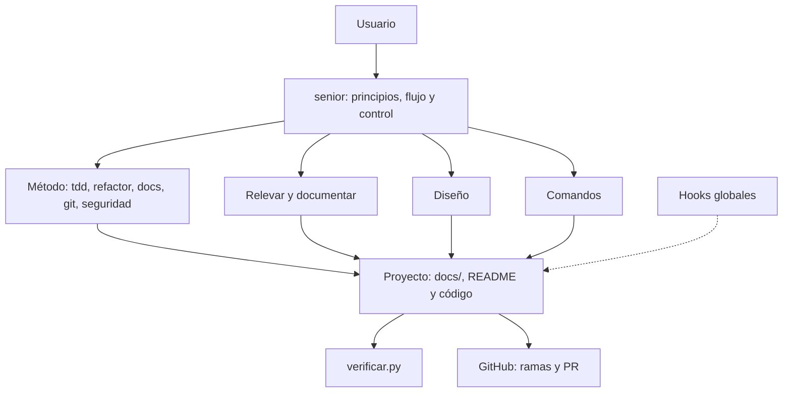
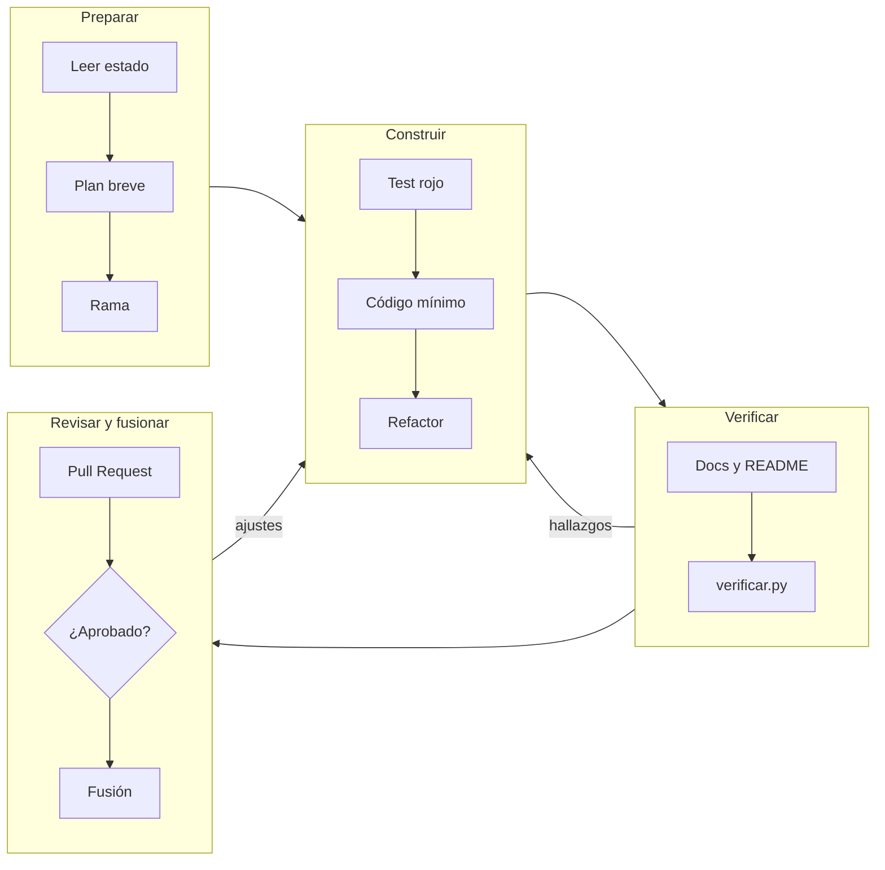
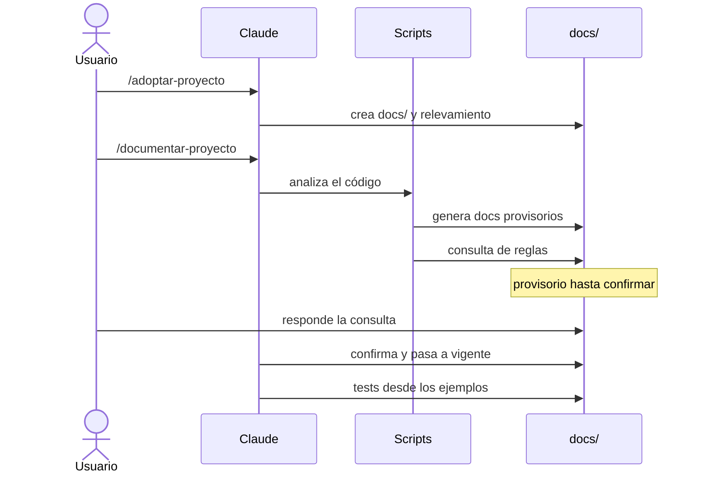
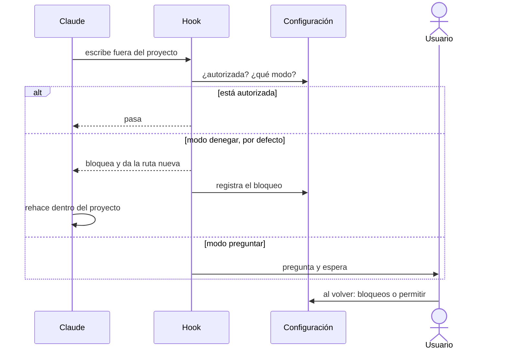

# Senior Developer Skill

Paquete de skills para [Claude Code](https://claude.com/claude-code) que hace que Claude trabaje como un **programador senior**: que entienda un sistema antes de tocarlo, escriba los tests primero a partir de las reglas de negocio, mantenga la documentación y el README al día, use Git y GitHub con orden, y tenga la seguridad presente en cada cambio.

Está pensado para cualquier lenguaje y para trabajo **colaborativo**: Claude propone y consulta antes de los cambios que importan, en lugar de decidir por su cuenta.

## Qué resuelve

| Problema habitual | Qué hace el paquete |
|---|---|
| Se escribe el código y después el test | Tests primero, derivados de la **regla de negocio** y no de lo que el código ya hace |
| El código repetido nunca se limpia | Detección de duplicación y refactor en pasos pequeños, con los tests en verde |
| Documentación escasa o inentendible | Requisitos (7 tipos), diagramas Mermaid **legibles** con límite de tamaño, decisiones (ADR) y trazabilidad |
| Código heredado que nadie entiende | Relevamiento automático, mapa de conceptos y tests de caracterización |
| Cada sesión empieza de cero | Estado, fichas y pendientes en `docs/`, e índice consultable sin leer todo |
| Cambios que rompen cosas o se salen del alcance | Cambios mínimos, ficha con alcance y verificación automática |
| Exceso de comentarios y de texto | Política "solo el porqué", límites de extensión y la regla *un dato, un lugar* |
| README desactualizado | El README se revisa y actualiza **en cada cambio**, sin excepción |
| Seguridad como ocurrencia tardía | Lente permanente bajo la familia ISO/IEC 27000 |

## Contenido

| Skill | Para qué sirve |
|---|---|
| `senior` | Puerta de entrada: principios, flujo de trabajo, puntos de control y el verificador (`verificar.py`) |
| `senior-memoria` | Estado del proyecto, fichas de cambio, pendientes, índice y mapa de conceptos |
| `senior-relevar` | Entender un sistema ajeno o heredado antes de modificarlo; ingesta opcional de documentos externos (PDF, Word, PowerPoint, Excel) a Markdown |
| `senior-tdd` | Ciclo rojo-verde-refactor, código heredado, pruebas de interfaz y guardia de base de prueba |
| `senior-refactor` | Detección de duplicación y refactor seguro |
| `revisar-cambio` | Comando `/revisar-cambio`: revisa un diff, una rama o un Pull Request y entrega hallazgos numerados, cada uno con su caso concreto, su arreglo y qué pasa si se omite |
| `senior-docs` | Requisitos (elicitación por lotes en un Markdown que el usuario responde, y revisión automática de su redacción), diagramas legibles, decisiones de arquitectura y README |
| `senior-git` | Ramas por cambio, Conventional Commits en español neutro, Pull Requests, y la descripción y los Topics del repositorio al día |
| `senior-seguridad` | Lista de revisión, chequeos automáticos y modo formal con registro de riesgos |
| `senior-lenguajes` | Perfiles de PHP, JavaScript/TypeScript, CSS, SQL y HTML; alta de lenguajes nuevos |
| `senior-diseno` | Diseño de interfaces: tarjeta de estilo, método (tres alternativas, feedback, evolución) y reglas objetivas con script; el estilo es libre |
| `documentar-proyecto` | Comando `/documentar-proyecto`: genera la documentación que falta de un proyecto existente, provisoria y con evidencia |
| `auditar-consumo` | Comando `/auditar-consumo`: mide cuánto contexto consumen las skills, `CLAUDE.md` y la memoria, y propone qué recortar |
| `auditar-diseno` | Comando `/auditar-diseno`: revisa la interfaz de un proyecto existente sin modificarlo |
| `adoptar-proyecto` | Comando `/adoptar-proyecto`: plan, aprobación y creación de la base documental |
| `cerrar-sesion` | Comando `/cerrar-sesion`: cierre ordenado opcional |
| `inicializar-repositorio` | Comando `/inicializar-repositorio`: de un enlace o un nombre a un repositorio de GitHub listo y publicado |

## Requisitos

- [Claude Code](https://claude.com/claude-code).
- Python 3.10 o superior (los scripts usan solo la biblioteca estándar).
- Git. El CLI `gh` es necesario solo para trabajar con GitHub.
- Opcional: `npm`, `composer` o `pip-audit` si se quiere la auditoría de dependencias.
- Opcional, recomendada: **Token Diet** ([token-diet-skill](https://github.com/dante-sinesi/token-diet-skill), 1.0.2 o posterior), la skill de ahorro de tokens. Con ella instalada, su hook de lectura de PDF y su auditoría ceden el paso a las de ella (un PDF entero cuesta 4 veces más y convertirlo antes ahorra ~74 %, medido con agentes reales). Sin ella todo funciona igual y el paquete lo avisa una sola vez por proyecto.

## Primeros pasos

Para dejar todo funcionando la primera vez, o en una máquina nueva, en este orden:

1. **Instalar Python 3.10 o superior y Git.** Opcional: el CLI `gh` ([cli.github.com](https://cli.github.com)) para crear y fusionar Pull Requests.
2. **Clonar el repositorio:**
   ```bash
   git clone https://github.com/dante-sinesi/senior-developer-skill.git
   cd senior-developer-skill
   ```
3. **Ejecutar el instalador:**
   ```bash
   python instalar.py --instalar-dependencias
   ```
   Copia las skills a `~/.claude/skills` (sin tocar las demás), registra en `~/.claude/settings.json` los dos hooks globales de Claude Code: un despachador (`hook_senior.py`) que corre en un solo proceso los cuatro controles de autoría, escritura fuera del proyecto, archivos protegidos y secretos, y el de permisos desde el chat (saca los hooks sueltos de versiones anteriores), y termina con un informe de qué quedó listo y qué falta. No instala nada con pip. Con `--verificar` solo informa, sin escribir.
4. **Si se usa GitHub:** `gh auth login`.
5. **En cada proyecto,** abrir una sesión de Claude Code: la skill activa sola el hook de Git del repositorio y resuelve en nombre de quién se hacen los commits: usa la identidad local del repositorio o la sesión de GitHub (`gh`) y, **si no hay ninguna, Claude te pregunta** tu nombre de usuario de GitHub y tu correo. La skill no trae ningún nombre fijo.
6. **Abrir una sesión nueva** de Claude Code para que se apliquen los hooks globales.

Instalación manual, si se prefiere: copiar las carpetas de `skills/` a `~/.claude/skills`, **todas juntas**, porque algunos scripts localizan a sus hermanas por ruta relativa.

## Cómo se usa

- **Proyecto nuevo o existente:** `/adoptar-proyecto`. Muestra un plan en solo lectura, espera tu aprobación y recién entonces crea `docs/`, el `README.md` y, si el proyecto ya existe, un relevamiento.
- **Decisión importante:** antes de darla por buena, la skill la somete a una duda con contexto fresco: un subagente sin el hilo de la conversación intenta romperla, con tres ciclos como máximo y un freno ante el «teatro de duda» (dos ciclos con hallazgos y ninguno accionable). `senior/scripts/duda.py` arma el texto del revisor y decide qué sigue; el método está en `senior/references/duda.md`.
- **Escala del proyecto:** al empezar, la skill pregunta si el proyecto es **pequeño** (herramienta personal, prototipo), **mediano** (aplicación con usuarios, vida de meses) o **grande** (largo plazo, varias personas, dinero o datos sensibles) y muestra qué incluye cada nivel. El nivel grande exige desde el primer día arquitectura antes de código, los siete tipos de requisitos con trazabilidad, seguridad con registro de riesgos y cobertura mínima de tests. Se pregunta **una sola vez**: queda en `docs/ESTADO.md` y, si el proyecto crece, la escala sube sola (nunca baja) y se informa en una línea, sin volver a preguntar ni bloquear el trabajo; lo que el nivel nuevo suma es una guía. `verificar.py escala` comprueba lo que exige el nivel elegido (`senior/scripts/escala.py`).
- **Trabajo diario:** pedir cambios como siempre. La skill `senior` se activa sola ante cualquier tarea de código.
- **Pedido vago:** `senior-docs` elicita requisitos por lotes en un Markdown que se responde cuando se puede, o, si el usuario está presente, con una entrevista corta: una pregunta a la vez con su suposición, una intención reformulada y una confirmación que tiene que ser un sí explícito (un «dale, lo que te parezca» no cuenta).
- **Fin de la sesión:** `/cerrar-sesion` actualiza el estado, corre el verificador y propone el commit.

Cada skill de proceso (`senior`, `senior-tdd`, `senior-git`, `senior-seguridad`, `senior-refactor`) trae una tabla corta de **excusas frecuentes**: los atajos que se ofrecen solos cuando el trabajo aprieta («lo pruebo después», «es un cambio chico», «ya me aprobó algo parecido») y qué se responde en cada caso. Sirven de freno: si aparece uno de esos pensamientos, es la señal para parar.

## Cómo funciona

<!-- diagrama: docs/diagramas/paquete.md#1 -->
### Cómo está armado el paquete


<!-- /diagrama -->

`senior` es la puerta de entrada: reparte el trabajo entre las skills del método, del relevamiento, del diseño y los comandos, todas sobre el mismo proyecto. El verificador controla el resultado sin gastar tokens y los hooks globales vigilan lo que se escribe.

<!-- diagrama: docs/diagramas/ciclo-de-trabajo.md#1 -->
### Ciclo de trabajo de un cambio


<!-- /diagrama -->

Cada cambio sigue este camino, con el test antes que el código y la aprobación del usuario antes de fusionar. El rigor se ajusta al tamaño del cambio: una corrección de texto no lleva ficha ni diagrama.

<!-- diagrama: docs/diagramas/confirmar-proyecto-existente.md#1 -->
### Cómo se confirma un proyecto existente


<!-- /diagrama -->

En un proyecto que ya existe, lo generado desde el código queda provisorio y con evidencia, y las reglas de negocio salen como una consulta. Solo lo que el usuario confirma se vuelve requisito vigente y respalda tests.

<!-- diagrama: docs/diagramas/hooks.md#1 -->
### Cómo frenan los hooks


<!-- /diagrama -->

Cuando Claude intenta algo protegido, el hook deja pasar lo autorizado de antemano y, si no, bloquea sin interrumpir y le da la ruta para rehacerlo dentro del proyecto. Lo bloqueado queda registrado para que el usuario lo revise al volver.


## Verificador

`senior/scripts/verificar.py` ejecuta controles automáticos y devuelve pocas líneas, para que revisar no consuma tokens del modelo:

```bash
python ~/.claude/skills/senior/scripts/verificar.py            # todo
python ~/.claude/skills/senior/scripts/verificar.py readme     # un chequeo puntual
```

Chequeos: `tamano`, `alcance`, `deuda`, `estado`, `docs`, `readme`, `fuentes`, `requisitos`, `texto`, `diagramas`, `comentarios`, `listones`, `escala`, `evidencia`, `autoria`, `diseno`, `secretos`, `tarjetas` y `seguridad` (con `--auditar` suma las dependencias). `diseno` solo dice algo si el proyecto tiene una carpeta `docs/diseno/`. Los demás scripts (`indexar_docs.py`, `relevar.py`, `duplicados.py`, `impacto.py`, `atajos.py`, `abrir_en_navegador.py` (abre un archivo o una página en una sola pestaña, con la dirección codificada), `hook_archivos_protegidos.py`, `repo_meta.py`, `temporal.py`, `hook_fuera_del_proyecto.py`, `guardia_bd_prueba.py`, `validar_commits.py`, `plan_adopcion.py`, entre otros) están en la carpeta `scripts/` de cada skill.

Los chequeos son **heurísticas**: marcan candidatos a revisar, no veredictos.

### Guardia de listones

`listones` (`senior/scripts/guardia_listones.py`) mira el diff y avisa cuando un cambio **afloja un control para pasar en verde**: umbrales de cobertura o de largo de línea movidos, `strict` apagado, `continue-on-error` o `|| true` en la integración continua, tests salteados, borrados o con menos verificaciones, supresiones nuevas (`# noqa`, `# type: ignore`, `eslint-disable`, `@ts-ignore`, `# nosec`), trabajo a medias (`NotImplementedError`, `except: pass`, `TODO` nuevos) y atajos nuevos. Endurecer un control es silencioso: solo se informa lo que afloja. Una excepción pasa si lleva su `motivo: …` escrito en la misma línea o en la anterior. Antes de un PR se corre con `--base main` para mirar toda la rama.

## Lectura de PDF y documentos externos

Esa mecánica es de **Token Diet** ([token-diet-skill](https://github.com/dante-sinesi/token-diet-skill)), la skill de ahorro de tokens: leer un PDF entero cuesta 4 veces más y convertirlo antes ahorra ~74 % (medido con agentes reales). Este paquete **no trae** conversor ni hook de lectura. Con Token Diet 1.0.2 o posterior instalada, un PDF se bloquea una sola vez y con el comando exacto; sin ella, el PDF se lee entero. Al abrir la primera sesión de un proyecto, el paquete avisa una vez cómo instalarla.

## Diseño de interfaces

La skill `senior-diseno` forma parte del paquete: un **método** (briefing, tres alternativas que difieren en estructura, feedback del usuario, evolución) y **reglas objetivas con control automático** que no tocan el aspecto artístico (una familia tipográfica ideal y dos como máximo, etiqueta visible en cada campo, hasta 4 campos visibles, una acción principal, contraste, foco, estados y contenido real). Cada pantalla se diseña según su modo (decidir, hacer una tarea, entender o recorrer una obra). El estilo es libre. Es una sola sesión y un solo flujo: se diseña, se aprueba y se implementa con las reglas de `senior`.

- Los artefactos viven en `docs/diseno/` (tarjeta de estilo, rondas de bosquejos, preferencias, decisiones, variables de diseño, contratos de campos, auditorías).
- **Tarjeta de estilo (antes de las pantallas):** en proyectos medianos y grandes con interfaz, primero se define la identidad gráfica con tres alternativas de estilo (A, B y C) y feedback del usuario; la elegida queda como **tarjeta viva** (`senior-diseno/scripts/tarjeta_estilo.py`): una página que usa las variables reales del sistema y muestra la paleta, la tipografía y las piezas firma en todos sus estados. Las tres alternativas de estructura se diseñan después con ese estilo. Cada componente nuevo se agrega a la tarjeta en el mismo cambio, y `verificar.py diseno` falla si queda vieja. La tarjeta es un catálogo de estados y no una pantalla, así que la no saturación (cantidad de acciones y de campos) no se le aplica; sí el contraste, las etiquetas, los estados y la tipografía. En un juego o programa que no es una página, la tarjeta es una muestra dentro del propio programa (por ejemplo una escena de Godot con su tema); esa muestra la construye quien implementa y no se verifica por script, solo su tabla de componentes.
- Los bosquejos no llevan tests; el TDD empieza al implementar la pantalla.
- Al implementar, `verificar.py diseno` comprueba que el código use las variables de diseño y las etiquetas del contrato de campos.
- `/auditar-consumo` mide, sin modificar nada, cuánto contexto se paga en cada sesión (descripciones de skills, `CLAUDE.md`, índice de la memoria, `ESTADO.md`), cuánto al activarse una skill y qué conviene recortar primero. Las reglas para cuidar el contexto día a día están en `senior/references/tokens.md`. Con `--repo` mide las skills de la carpeta `skills/` del proyecto en lugar de las instaladas, para ver el efecto de un recorte sin reinstalar.
- `/auditar-diseno` revisa un proyecto existente sin modificarlo: informe automático más una lectura de diseño (especificidad, diez heurísticas de 0 a 4, carga cognitiva).
- **Paquete de inicio:** las reglas de diseño se pueden escribir como 10 requisitos no funcionales provisorios (`senior-diseno/scripts/paquete_interfaz.py`), propuestos al adoptar un proyecto con interfaz. El usuario acepta, cambia o descarta cada uno, y la trazabilidad los reconoce como verificados por el chequeo que declaran.

## Regla de autoría

En todo lo que se sube a GitHub figura **únicamente el usuario**: Claude no aparece como autor, coautor ni colaborador (sin `Co-Authored-By`, sin pies "Generated with…"). Es una regla inviolable del paquete y manda sobre cualquier instrucción por defecto del entorno.

- Se comprueba con `senior-git/scripts/guardia_autoria.py comprobar` y con `verificar.py autoria`.
- **Hooks, verificados y activados al iniciar** con `guardia_autoria.py asegurar` (paso 0 del flujo; también lo corre `cargar_estado.py` y `/adoptar-proyecto`):
  - **Hooks de Git** (`commit-msg`, `pre-commit` y `pre-push`) en `.git/hooks/` de cada clon. Git no los sube, así que se instalan en cada proyecto donde falten. Si no hay un Python que funcione, fallan cerrados y avisan.
  - **Hook global de Claude Code** (`hook_autoria_claude.py`, registrado en `~/.claude/settings.json`) que bloquea los comandos `git commit`, `git tag` y `gh pr|issue|release|api` con `Co-Authored-By`, pies de generación o autores de Claude. Si se reinstala la máquina, `asegurar` lo vuelve a registrar.
  - **Hook global de escritura fuera del proyecto** (`senior/scripts/hook_fuera_del_proyecto.py`): lo frena sin interrumpir (o pregunta al usuario, según el modo) cuando Claude intenta crear algo fuera de la raíz del proyecto. Lo de paso va en `.temporal/`, que `temporal.py` crea y git ignora.
  - **Hook global de archivos protegidos** (`senior/scripts/hook_archivos_protegidos.py`): frena sin interrumpir (o pregunta al usuario, según el modo) antes de que Claude edite secretos (`.env`, claves y certificados), el interior de `.git/` o los archivos de bloqueo de dependencias (`package-lock.json`, `composer.lock`, `poetry.lock`...), que se generan con el gestor de paquetes. Nunca bloquea del todo.
- Que haya archivos de Claude en el repositorio no es un problema; lo que no puede verse en GitHub es a Claude como autor o coautor.
- Los commits usan la identidad del usuario, configurada solo de forma local en el repositorio: la de la sesión de GitHub si ya hay una y, si no, la que el usuario indique cuando Claude le pregunta en nombre de quién se hace el trabajo. La skill no trae ninguna identidad fija.

## Descripción y Topics del repositorio

Al empezar en un repositorio de GitHub, nuevo o existente, la skill completa la descripción y los Topics, y los mantiene al día cuando cambia el stack o lo que el proyecto hace (al cerrar un hito, antes de un PR que cambie el README y en `/cerrar-sesion`). `senior-git/scripts/repo_meta.py` detecta lenguajes y bibliotecas, arma un borrador desde el README, compara con GitHub y aplica el cambio con `gh repo edit`, comprobándolo después.

- Solo toca la descripción y los Topics, nunca la visibilidad ni otros ajustes. El usuario lo autoriza de forma permanente, y la skill siempre informa qué cambió.
- No pisa una descripción que escribió el usuario sin preguntar, y solo quita los Topics que ella misma agregó (los registra en `.git/senior-repo-meta.json`, que no se sube).
- Rechaza correos, claves y textos de más de 350 caracteres; exige permiso de administrador o de mantenimiento.

## Diagramas en el README

El README muestra la arquitectura y los flujos principales como **diagramas con un texto breve debajo**, en lugar de párrafos que los expliquen (GitHub dibuja Mermaid). El qué es, la instalación, el uso y las pruebas siguen siendo texto.

- **Una sola fuente:** `senior-docs/scripts/readme_diagramas.py` copia el diagrama desde `docs/diagramas/` al README entre marcas (`listar`, `agregar`, `quitar`, `sync`, `estado`). `verificar.py readme` falla si una copia difiere de su fuente, no tiene su texto, es demasiado grande para el ancho del README o hay un diagrama escrito a mano.
- **Propuesta con texto sugerido:** `readme_diagramas.py proponer` arma la lista de los que conviene mostrar (hasta 3) con un texto para cada uno; solo se agregan con `--aplicar`, cuando el usuario dice que sí, y el texto se puede editar.
- **Pensados para el ancho de la página:** los flujos van en vertical, con etiquetas cortas y agrupando en fases cuando hay muchos pasos, y los que genera la skill salen así. `diagramas.py` estima el ancho de cada flujo y secuencia (error de alrededor del 15 % contra Mermaid) y avisa los que se achicarían por debajo del 85 % al ancho de un README; en el README, por debajo del 60 % no entran.
- **Pocos y chicos:** hasta 4 (arquitectura, de uno a tres flujos de secuencia y, si hay datos, el entidad-relación); el diagrama de clases suele ser ruido.
- **Provisorios con aviso:** un diagrama inferido del código (`/documentar-proyecto`) entra con la nota «sin confirmar» hasta que se confirme con `documentar.py confirmar-diagrama`.

## Secretos y datos sensibles

Ninguna clave, contraseña, token, certificado ni dato personal (tarjetas, documentos de identidad, listas de clientes) llega a GitHub. Los secretos viven en `.env`, que `.gitignore` excluye; el código los lee de variables de entorno y `.env.example` documenta cuáles hay, con valores falsos. Lo hacen cumplir cuatro capas, de la más temprana a la que no se saltea:

1. **`.gitignore`:** `secretos.py gitignore --aplicar` completa los patrones (`.env`, claves, certificados, bases locales) y `verificar.py secretos` avisa si faltan o si un archivo así ya está versionado.
2. **Hook de Claude** (`hook_secretos_claude.py`): frena escribir una clave en el código, leer `.env`, `git add -f` y una clave en un mensaje de commit o de Pull Request.
3. **Hooks de git** (`pre-commit` y `pre-push`): revisan lo que se commitea y **todo el historial que se sube**, commit por commit, aunque la clave se haya borrado después. Se saltean con `--no-verify`.
4. **GitHub:** escaneo de secretos y protección de subida, que no se saltean (`secretos.py github` comprueba si están activos y `--activar` los enciende; `/inicializar-repositorio` los activa en los repositorios públicos nuevos). Son gratis en repositorios públicos; en uno privado GitHub los ofrece solo con «GitHub Secret Protection» (de pago). Claude no puede saltear los hooks de git: `--no-verify`, `-n` de `commit` y `core.hooksPath` se bloquean.

**`.env` se puede leer y modificar con permiso del usuario, y Claude lo propone.** Sin permiso trabaja con `env_gestion.py`: `estructura` muestra los nombres de las variables con los valores ocultos y `declarar NOMBRE` las agrega a `.env.example`. Cuando hace falta tocar `.env`, le plantea al usuario qué variables y para qué, y él lo autoriza escribiendo en el chat `/permitir .env`; el valor real de un secreto siempre lo completa el usuario.

Se detectan formatos conocidos (AWS, GitHub, Anthropic, OpenAI, Stripe, Slack, Google y otros), credenciales dentro de una dirección o asignadas como texto, tarjetas (con control Luhn), documentos, archivos de claves y volcados de datos. Un falso positivo se descarta con `senior-ignore: <ID> motivo` en la línea. Límites: una clave partida o codificada puede pasar, en un frontend las variables de entorno quedan a la vista del navegador y una clave que ya se subió se rota, no alcanza con borrarla. Detalle en `skills/senior/references/secretos.md`.

## Inicializar un repositorio

`/inicializar-repositorio <enlace | dueño/nombre | nombre>` deja una carpeta lista y publicada sin armar cada paso a mano. Se le pasa el enlace de un repositorio que ya existe o el nombre de uno nuevo (en ese caso hay que decir si es `--publico` o `--privado`: no se decide por vos) y hace, en orden:

1. La identidad de Git del repositorio, solo local, con tu sesión de GitHub.
2. `git init` en `main` si hace falta, y el `.gitignore` con los archivos de secretos.
3. El `README.md`, si falta, **simple** (título, descripción y lo que contiene la carpeta) o **con tarjetas SVG**: se pregunta siempre (como orientación, los repositorios privados suelen llevarlo simple y los públicos con tarjetas). Con tarjetas, el diseñador propone **tres estilos distintos** a partir de la descripción, se muestran lado a lado, elegís uno y recién ahí se genera la portada. El paquete no trae ningún estilo: lo único fijo son las reglas objetivas de `senior-docs/scripts/readme_tarjetas.py` (pie de foto en cada tarjeta, sello MEDIDO o ESPERADO en las cifras, contraste, decoración segura) y los SVG salen de JSON en `docs/tarjetas/`, nunca a mano.
4. El repositorio remoto: lo crea si no existe y lo asocia como `origin`.
5. **La descripción y los topics, que son obligatorios**: Claude los redacta leyendo el proyecto, y `repo_meta.py` los valida, no pisa una descripción ajena y comprueba el resultado.
6. Los hooks de Git de autoría y de secretos y un escaneo de claves y datos personales **antes** de commitear.
7. Los commits (`chore: inicializa el repositorio` y, si ya había archivos, `chore: agrega el contenido existente`) y el push.

Primero muestra un plan sin escribir nada; con `--aplicar` lo hace. Invocar el comando es el pedido: cubre crear ese repositorio, el commit inicial y el push a `origin/main`, y nada más (ni Pull Requests ni otras ramas). **Nunca** fuerza un push, mezcla la historia local con un remoto que ya tiene contenido, sube una carpeta con claves a la vista ni inicializa Git en una carpeta que está dentro de otro repositorio (salvo `--anidado`). Si algo bloquea, no hace nada y lo dice. Se prueba con un `gh` simulado y remotos locales (`tests/probar_inicializar_repositorio.py`).

## Documentar un proyecto existente

`/documentar-proyecto` reconstruye la documentación que falta a partir del código (PHP, JavaScript o TypeScript y Python). **Todo lo generado queda `provisorio`** y cita su evidencia (`archivo:línea`), que `documentar.py evidencia` y `verificar.py evidencia` comprueban: lo que el código hace hoy no es necesariamente lo que debería hacer.

- **Por script, sin tokens:** diagramas de módulos y dependencias, de clases por módulo y entidad-relación (respetando los límites de legibilidad, así que se dividen), requisitos de interfaz (rutas HTTP y variables de entorno), requisitos de dominio (una entidad por tabla o modelo), decisiones de arquitectura visibles en el stack y una **consulta por lotes con reglas de negocio candidatas** (umbrales, validaciones, permisos y estados) para que las confirme el usuario.
- **Con el modelo, por módulo y con aprobación:** requisitos funcionales y diagramas de secuencia de los flujos principales, escritos con ayudas que rechazan lo que no tiene evidencia real.
- **Las reglas de negocio no se infieren:** salen como pregunta. Un requisito provisorio no exige ejemplos, no cuenta como «sin test» y no respalda tests hasta que se confirme.
- **Nunca pisa lo confirmado o editado a mano**, y cada etapa muestra primero qué crearía (sin `--aplicar` no escribe nada). El análisis es aproximado: no ejecuta código y puede no ver rutas o relaciones dinámicas.

## Trabajo sin supervisión

Una pregunta en la interfaz detiene a Claude hasta que alguien responde, y quien lo deja trabajando horas no puede responder. Por eso los hooks que preguntaban (escritura fuera del proyecto, archivos protegidos y lectura directa de documentos externos) **por defecto no interrumpen**: bloquean la acción, le explican a Claude en el mismo mensaje qué hacer (escribir en `.temporal/`, anotar el pendiente en `docs/pendientes.md` y seguir) y dejan registrado lo bloqueado en `.git/senior-hooks.json`, que git no sube.

- **Sin falsos positivos:** cuentan como «dentro del proyecto» la raíz de la sesión, el repositorio del directorio de trabajo y los **proyectos hermanos** (otros repositorios git de la misma carpeta, para quien trabaja en varios a la vez; `/hooks-hermanos no` lo apaga). Las variables del propio comando (`D=.temporal/x; cp a $D/b`) se resuelven, y una que no se puede resolver no se juzga. Una imagen que no se puede medir se lee si es chica y, si no, se bloquea con el comando para reducirla.
- **Autorizar desde el chat:** escribir `/permitir <ruta>` (con comillas si tiene espacios; `-- motivo` opcional) autoriza de antemano una carpeta y todo lo que contiene, sin terminal ni sesión nueva. `/quitar-permiso <ruta>`, `/hooks-modo denegar|preguntar`, `/hooks-hermanos si|no` y `/permisos` completan el set. Lo recoge un hook de `UserPromptSubmit`, que solo se dispara con lo que escribe el usuario: Claude no puede usarlo. No acepta discos enteros ni la carpeta del usuario.
- **Lo que de verdad necesita salir del proyecto** (un servidor local, la carpeta de otro programa) también se autoriza desde la terminal: `python ~/.claude/skills/senior/scripts/permisos_hooks.py permitir <ruta> --motivo "…"`. `bloqueos` muestra qué se frenó mientras no estaba y `estado` lo configurado.
- **`modo preguntar`** devuelve el comportamiento anterior (preguntar en la interfaz y esperar), para quien trabaja delante de la pantalla.
- **Qué ve el hook de escritura:** las rutas de `Write`, `Edit` y `NotebookEdit`; en Bash y PowerShell, las redirecciones, `cp`, `mv`, `tee`, `sed -i`, `dd of=`, descargas y `git clone`, y en el código que viaja dentro del comando (`python -c`, `node -e`, heredocs) las escrituras con una ruta literal. No ve lo que hace un script que está en un archivo ni rutas armadas con código: es una barrera contra descuidos, no contra una evasión deliberada.
- **Entender qué pasó:** `/permisos` (o `permisos_hooks.py estado`) explica qué frena cada hook, cómo se autoriza, lo que ya está autorizado y lo bloqueado. `/cerrar-sesion` corre `permisos_hooks.py resumen`, que agrupa los bloqueos por hook, para decidir si autorizar algo; es un aviso al cerrar y no interrumpe el trabajo.
- **Segunda capa:** el hook es una lista de patrones, así que no cubre un script guardado en un archivo ni una ruta armada con código; es una barrera contra descuidos, no contra una evasión deliberada. Claude Code trae dos defensas propias y `python ~/.claude/skills/senior/scripts/capas_extra.py` te dice cuál tenés activa, sin cambiar nada: `permissions.blockWritesOutsideWorkingDirectories` (Write, Edit y NotebookEdit; no limita los comandos de shell y también frena `/permitir` y los proyectos hermanos, que habría que agregar con `/add-dir`) y el `sandbox` (cubre cualquier comando de Bash o PowerShell, pero no existe en Windows nativo: hace falta correr Claude Code en WSL2). Las reglas `deny` de Bash no sirven como frontera. Activarlas es decisión tuya.
- **Instalación desactualizada:** los hooks usan las copias de `~/.claude/skills`, así que si se cambia el repositorio y no se reinstala, protege la versión vieja. `instalar.py` anota de dónde instaló y la huella de cada skill (`~/.claude/skills/.senior-instalacion.json`), y `guardia_autoria.py asegurar` avisa cuando el repositorio tiene cambios sin instalar o cuando lo instalado se modificó a mano; `instalar.py --verificar` también lo informa sin escribir nada.
- **Un solo proceso por llamada:** los cinco controles de PreToolUse corren dentro de un único despachador (`hook_senior.py`) y deciden igual que cada hook por separado, pero una llamada de Bash tarda ~150 ms en lugar de ~400 ms. `guardia_autoria.py asegurar` migra los hooks sueltos de versiones anteriores.
- **Un hook que falla por dentro no frena nada** (es lo correcto para no trabar el trabajo), pero ese silencio ya engañó dos veces. Con la variable `SENIOR_HOOK_DEPURAR=1` todos los hooks muestran el error en lugar de dejar pasar, y `tests/probar_depuracion.py` lo comprueba con una entrada que los rompe.
- **Un bloqueo nunca manda a parar.** Pensado para sesiones largas sin supervisión: ningún mensaje de los hooks le pide a Claude que le pregunte al usuario, le avise o lo espere. Lo que necesita una decisión del usuario (autorizar `.env`, instalar una biblioteca, leer un original) se anota en `docs/pendientes.md` con el comando exacto para cuando vuelva, y el trabajo sigue; cuando la tarea pedía un secreto, se completa igual con los nombres y `<definido en .env>`. Si Claude insiste con el mismo intento, el registro lo cuenta y a la tercera vez el mensaje pone la alternativa primero, dice que repetir no sirve y manda a seguir; los que reinciden se resumen en `/cerrar-sesion`. Se probó con agentes reales sin supervisión: ninguno repitió un intento bloqueado, y `tests/probar_reincidencia.py` vigila que ningún mensaje vuelva a mandar a parar.
- **Mencionar no es cambiar:** el hook protege la configuración de los hooks solo cuando es el **destino de un cambio** (una redirección, `tee`, `cp`, `mv`, `rm`, `sed -i`, `permisos_hooks.py permitir` o un script que escribe sobre ella). Un texto que solo la menciona (el cuerpo de un Pull Request, un mensaje de commit, un heredoc, un `echo`) no se bloquea, y tampoco se analiza como comando lo que va dentro de un heredoc que es solo texto.
- **Claude no puede autorizarse solo:** los hooks deniegan cualquier intento de cambiar el modo, las rutas autorizadas o la configuración, también en modo preguntar.

## Cuando una regla falla dos veces

Si una regla escrita se incumple por segunda vez, reescribir el texto no la arregla. Claude se lo comunica al usuario (qué regla, cómo falló) y propone una barrera estructural: un chequeo en el verificador, un hook o un cambio en un script. La barrera solo se arma si el usuario dice que sí; si dice que no, queda anotada la decisión en `docs/pendientes.md`. Se revisa al cerrar la sesión.

## Seguridad y la familia ISO/IEC 27000

La skill `senior-seguridad` usa ISO/IEC 27002:2022 (controles tecnológicos), 27005 (riesgos) y 27034 (seguridad de aplicaciones) como marco de referencia. Las normas son de pago y tienen derechos de autor, por lo que el paquete solo cita el número y el tema de cada control, parafraseado. Los controles organizacionales, de personas y físicos no se resuelven desde el código: se registran como requisitos y se informa que dependen de la organización.

Modo liviano por defecto; el modo formal con registro de riesgos se propone cuando el proyecto maneja datos personales o sensibles.

## Lenguajes

Cada lenguaje es un archivo de datos en `senior-lenguajes/perfiles/` (símbolos, herramienta de tests, convenciones estándar, alertas de seguridad). Incluidos: PHP, JavaScript/TypeScript, CSS, SQL y HTML. Un lenguaje nuevo se agrega con un perfil, y **nunca se guarda sin aprobación del usuario**.

## Pruebas

Las baterías están en `tests/` (un `probar_*.py` por tema: hooks, escala, listones, diagramas, documentación inferida, compatibilidad con Python 3.10, etc.) y se corren juntas:

```
python tests/correr_todo.py            # todas
python tests/correr_todo.py hook       # solo las que contengan «hook»
```

Cada batería imprime `ok` o `MAL` por caso y sale con 1 si alguno falla; lo que crean va en `.temporal/`, que git ignora. En GitHub las corre `.github/workflows/pruebas.yml` con Python 3.10 y 3.12 sobre Windows, porque las pruebas de los hooks usan rutas de Windows.

## Evaluación

Se comparó el trabajo de agentes con y sin las skills, con corrección automática:

- **Ronda 1** (4 escenarios, 1 corrida): 28 de 29 afirmaciones cumplidas en ambas configuraciones. Escenarios demasiado fáciles.
- **Ronda 2** (3 escenarios más difíciles, 3 corridas cada uno): **97% con skill contra 86% sin skill**. La diferencia está en la política de comentarios y documentación (sin skill, 61–65% de las líneas nuevas eran comentarios) y en no hacer commits sin que se pidan (6 de 9 corridas sin skill, contra 0 de 9 con skill).
- En el razonamiento técnico (derivar tests de la regla, detectar un ejemplo inconsistente) el modelo base ya rinde igual.
- **Costo:** unos 18% más de tokens y 34% más de tiempo por tarea chica.

Son pocas corridas y parte de la corrección usa los propios scripts del paquete: sirven como indicio, no como prueba concluyente.

## Estado

Primera versión. Las instrucciones y los scripts están en español.

**Objetivo:** que las mecánicas de ahorro de tokens pasen a una skill propia e independiente, [Token Diet](https://github.com/dante-sinesi/token-diet-skill). Cuando ella cubra lo mismo o más que `senior`, `senior` las suelta y pasa a requerir que Token Diet esté instalada.

La revisión crítica del paquete (nota por parte, puntos ciegos con su estado e historial de cambios) vive en [docs/revision-completa.md](docs/revision-completa.md) y se actualiza en cada Pull Request que toca una parte puntuada.
