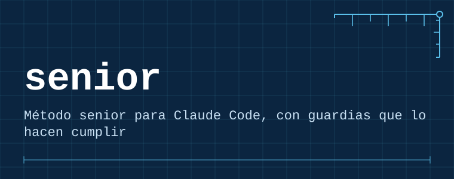
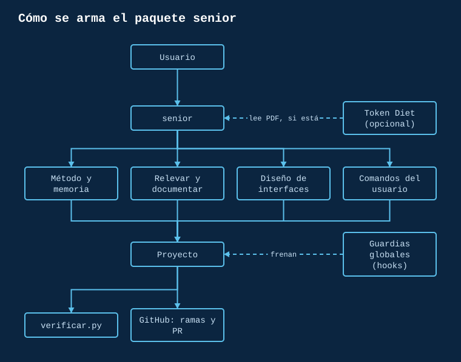
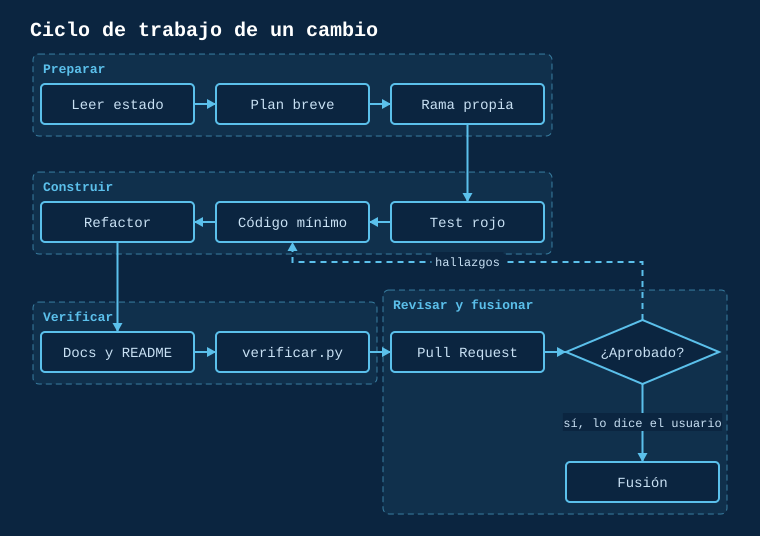
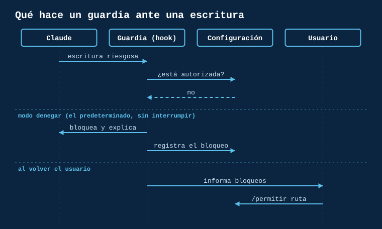

<p align="center"><br><sub>Portada del repositorio senior: un método de trabajo para programar con Claude Code, con tests primero, cambios mínimos y guardias automáticos.</sub></p>

Paquete de skills para [Claude Code](https://claude.com/claude-code) que hace que Claude trabaje como un **programador senior**: que entienda un sistema antes de tocarlo, escriba los tests primero a partir de las reglas de negocio, mantenga la documentación y el README al día, use Git y GitHub con orden, y tenga la seguridad presente en cada cambio.

Está pensado para cualquier lenguaje y para trabajo **colaborativo**: Claude propone y consulta antes de los cambios que importan, en lugar de decidir por su cuenta.

## Qué resuelve

| Problema habitual | Qué hace el paquete |
|---|---|
| Se escribe el código y después el test | Tests primero, derivados de la **regla de negocio** |
| El código repetido nunca se limpia | Refactor en pasos pequeños, con los tests en verde |
| Documentación escasa o inentendible | Requisitos, diagramas legibles, decisiones (ADR) y trazabilidad |
| Código heredado que nadie entiende | Relevamiento automático y tests de caracterización |
| Cada sesión empieza de cero | Estado, fichas y pendientes en `docs/` |
| Cambios que se salen del alcance | Cambios mínimos y verificación automática |
| README desactualizado | Se actualiza **en cada cambio** |
| Seguridad como ocurrencia tardía | Lente permanente bajo ISO/IEC 27000 y guardias contra secretos |

## Qué se midió

Cifras medidas con agentes reales, en tareas de código chicas (detalle, límites y tareas en [docs/revision-completa.md](docs/revision-completa.md)):

<p align="center"><br><sub>Medido con agentes reales en tres tareas de código y tres repeticiones: con senior el agente agregó tests en las nueve corridas; sin skills, en seis.</sub></p>

<p align="center"><br><sub>Medido en dos revisiones a ciegas de tres pedidos cada una, con un solo juez: el código hecho con senior se prefirió en los seis.</sub></p>

<p align="center"><br><sub>Medido con agentes reales: 1,31 USD contra 0,69 USD estimados en nueve corridas; el costo viene de las vueltas del método, no del tamaño del texto.</sub></p>

Son pocas tareas, un solo modelo y un solo juez: sirven para no engañarse, no para prometer lo mismo en cualquier proyecto.

## Contenido

| Skill | Para qué sirve |
|---|---|
| `senior` | Puerta de entrada: principios, flujo de trabajo, puntos de control y el verificador (`verificar.py`) |
| `senior-memoria` | Estado del proyecto, fichas de cambio, pendientes, índice y mapa de conceptos |
| `senior-relevar` | Entender un sistema ajeno o heredado antes de modificarlo; ingesta opcional de documentos externos (PDF, Word, PowerPoint, Excel) a Markdown |
| `senior-tdd` | Ciclo rojo-verde-refactor, código heredado, pruebas de interfaz y guardia de base de prueba |
| `senior-refactor` | Detección de duplicación y refactor seguro |
| `revisar-cambio` | Comando `/revisar-cambio`: revisa un diff, una rama o un Pull Request y entrega hallazgos numerados, cada uno con su caso concreto, su arreglo y qué pasa si se omite |
| `senior-docs` | Requisitos (elicitación por lotes en un Markdown que el usuario responde, y revisión automática de su redacción), diagramas legibles, decisiones de arquitectura y README |
| `senior-git` | Ramas por cambio, Conventional Commits en español neutro, Pull Requests, y la descripción y los Topics del repositorio al día |
| `senior-seguridad` | Lista de revisión, chequeos automáticos y modo formal con registro de riesgos |
| `senior-lenguajes` | Perfiles de PHP, JavaScript/TypeScript, CSS, SQL y HTML; alta de lenguajes nuevos |
| `senior-diseno` | Diseño de interfaces: tarjeta de estilo, método (tres alternativas, feedback, evolución) y reglas objetivas con script; el estilo es libre |
| `documentar-proyecto` | Comando `/documentar-proyecto`: genera la documentación que falta de un proyecto existente, provisoria y con evidencia |
| `auditar-consumo` | Comando `/auditar-consumo`: mide cuánto contexto consumen las skills, `CLAUDE.md` y la memoria, y propone qué recortar |
| `auditar-diseno` | Comando `/auditar-diseno`: revisa la interfaz de un proyecto existente sin modificarlo |
| `adoptar-proyecto` | Comando `/adoptar-proyecto`: plan, aprobación y creación de la base documental |
| `cerrar-sesion` | Comando `/cerrar-sesion`: cierre ordenado opcional |
| `inicializar-repositorio` | Comando `/inicializar-repositorio`: de un enlace o un nombre a un repositorio de GitHub listo y publicado |
| `trabajo-autonomo` | Comando `/trabajo-autonomo` (solo con el comando, nunca se activa solo): deja una tarea trabajando sin supervisión, con puntos de guardado en una rama propia `auto/…`, bloqueos que se anotan sin esperar y un informe al volver |

## Requisitos

- [Claude Code](https://claude.com/claude-code), Python 3.10 o superior (solo biblioteca estándar) y Git. El CLI `gh` solo para trabajar con GitHub.
- Opcional, recomendada: **Token Diet** ([token-diet-skill](https://github.com/dante-sinesi/token-diet-skill), 1.0.2 o posterior), que se ocupa de leer PDF y archivos largos. Sin ella todo funciona igual y el paquete lo avisa una sola vez por proyecto.

## Primeros pasos

```bash
git clone https://github.com/dante-sinesi/senior-developer-skill.git
cd senior-developer-skill
python instalar.py --instalar-dependencias
```

El instalador copia las skills a `~/.claude/skills` (sin tocar las demás), registra los dos hooks globales de Claude Code (un despachador, `hook_senior.py`, que corre en un solo proceso los controles de autoría, escritura fuera del proyecto, archivos protegidos y secretos, y el de permisos desde el chat) y termina con un informe de qué quedó listo y qué falta (`--verificar` solo informa). Después abrí una sesión nueva de Claude Code para que se apliquen los hooks. En cada proyecto, la skill resuelve en nombre de quién se hacen los commits: usa la identidad local o la sesión de `gh` y, si no hay ninguna, te pregunta tu usuario de GitHub y tu correo. Instalación manual: copiar las carpetas de `skills/` a `~/.claude/skills`, todas juntas.

## Cómo se usa

- **Proyecto nuevo o existente:** `/adoptar-proyecto` muestra un plan, espera tu aprobación y recién entonces crea `docs/`, el `README.md` y, si el proyecto ya existe, un relevamiento.
- **Trabajo diario:** pedir cambios como siempre; `senior` se activa sola ante cualquier tarea de código.
- **Pedido vago:** se elicitan los requisitos por lotes o con una entrevista corta, y se pide un sí explícito.
- **Fin de la sesión:** `/cerrar-sesion` actualiza el estado, corre el verificador y propone el commit.
- **Cambios largos sin supervisión:** `/trabajo-autonomo`, con rama propia y sin push ni fusión.

Más detalle en la [referencia de funcionamiento](docs/referencia.md#cómo-se-usa-con-más-detalle).

## Cómo funciona

### Cómo está armado el paquete

<p align="center"><br><sub>Arquitectura del paquete: el usuario habla con la skill senior, que reparte el trabajo entre método, relevamiento, diseño y comandos; todo actúa sobre el proyecto, vigilado por guardias globales, verificado por verificar.py y publicado por ramas y Pull Requests.</sub></p>

`senior` es la puerta de entrada: reparte el trabajo entre el método, el relevamiento, el diseño y los comandos, todos sobre el mismo proyecto. El verificador controla el resultado sin gastar tokens, los guardias globales frenan lo que no debe escribirse y Token Diet, si está instalada, se ocupa de leer PDF y archivos largos.

### Ciclo de trabajo de un cambio

<p align="center"><br><sub>Ciclo de trabajo de un cambio: leer el estado, planear, abrir una rama, escribir el test que falla, el código mínimo y el refactor, actualizar la documentación, correr verificar.py y abrir el Pull Request; solo se fusiona si el usuario lo aprueba, y los hallazgos vuelven al código.</sub></p>

Cada cambio sigue este camino, con el test antes que el código y la aprobación del usuario antes de fusionar. El rigor se ajusta al tamaño del cambio: una corrección de texto no lleva ficha ni diagrama.

### Cómo se confirma un proyecto existente

<p align="center"><br><sub>Secuencia de adopción: el usuario pide /adoptar-proyecto, Claude muestra un plan y espera aprobación, los scripts generan documentación provisoria con evidencia, y solo lo que el usuario confirma pasa a ser regla de negocio con sus tests.</sub></p>

En un proyecto que ya existe, lo generado desde el código queda provisorio y con evidencia, y las reglas de negocio salen como una consulta. Solo lo que el usuario confirma se vuelve requisito vigente y respalda tests.

### Cómo frenan los guardias

<p align="center"><br><sub>Secuencia de un guardia: ante una escritura fuera del proyecto, sobre un archivo protegido o con un secreto, el hook consulta la configuración, bloquea y explica sin interrumpir el trabajo, registra el bloqueo y el usuario decide al volver si autoriza esa ruta.</sub></p>

Cuando Claude intenta algo protegido (escribir fuera del proyecto, tocar un archivo protegido o dejar un secreto en el código), el guardia consulta la configuración y, si no está autorizado, bloquea sin interrumpir y explica cómo rehacerlo dentro del proyecto. Lo bloqueado queda registrado para que el usuario lo revise al volver.

## Verificador

`senior/scripts/verificar.py` corre unos veinte controles automáticos y devuelve pocas líneas, para que revisar no consuma tokens del modelo:

```bash
python ~/.claude/skills/senior/scripts/verificar.py            # todo
python ~/.claude/skills/senior/scripts/verificar.py readme     # un chequeo puntual
```

Los chequeos son **heurísticas**: marcan candidatos a revisar, no veredictos.

## Más información

- [Referencia de funcionamiento](docs/referencia.md): guardias, secretos, autoría, diseño, trabajo sin supervisión y cada comando con su detalle.
- [Guía del paquete](docs/guia-del-paquete.md): punto por punto, qué ataca cada una de las 18 skills y qué está medido.
- [Revisión crítica](docs/revision-completa.md): nota por parte, puntos ciegos con su estado e historial; se actualiza en cada Pull Request.

## Pruebas

Las baterías están en `tests/` (un `probar_*.py` por tema: hooks, escala, listones, diagramas, documentación inferida, compatibilidad con Python 3.10, etc.) y se corren juntas:

```
python tests/correr_todo.py            # todas
python tests/correr_todo.py hook       # solo las que contengan «hook»
```

Cada batería imprime `ok` o `MAL` por caso y sale con 1 si alguno falla; lo que crean va en `.temporal/`, que git ignora. En GitHub las corre `.github/workflows/pruebas.yml` con Python 3.10 y 3.12 sobre Windows, porque las pruebas de los hooks usan rutas de Windows.

## Estado

Primera versión; las instrucciones y los scripts están en español. Las mecánicas de ahorro de tokens van a [Token Diet](https://github.com/dante-sinesi/token-diet-skill), una skill independiente de la que `senior` depende de forma blanda.
