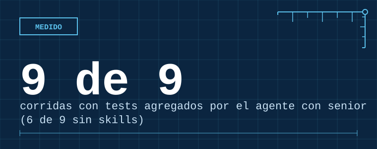
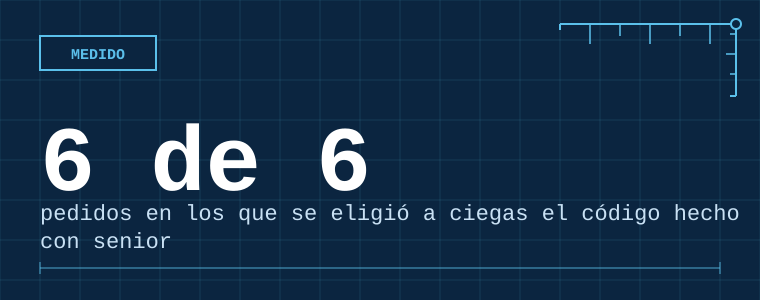
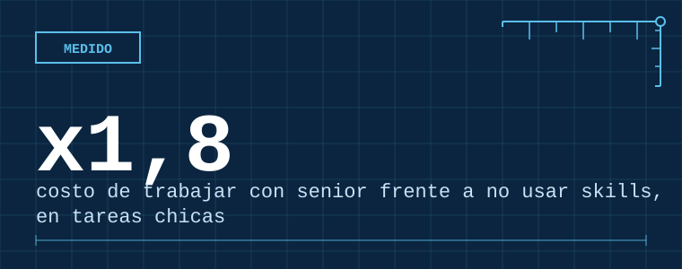
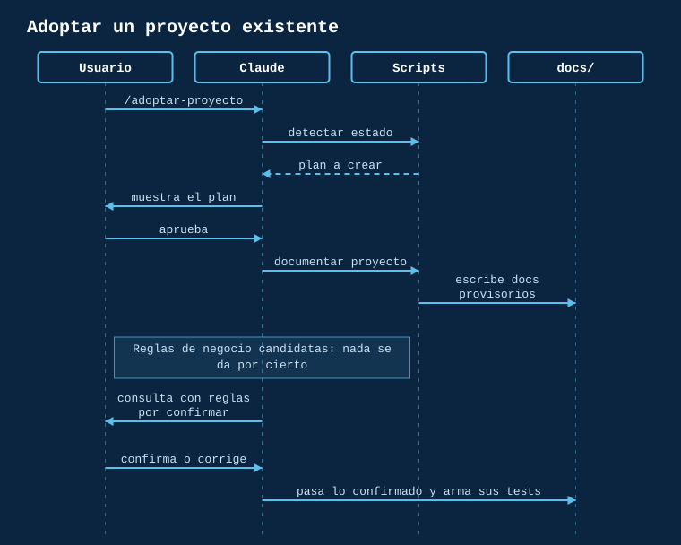

<p align="center"><br><sub>Portada de senior: un paquete que le enseña a Claude Code a trabajar con el cuidado de un programador senior.</sub></p>

Un paquete de skills para [Claude Code](https://claude.com/claude-code) que le enseña a trabajar con el cuidado de un programador senior.

## Qué es

Claude Code escribe código muy rápido, pero a veces se apura: cambia más de lo que se le pidió, no prueba lo que hace y se olvida de lo que pasó en la sesión anterior.

Este paquete le enseña a trabajar con más cuidado: entender antes de tocar, probar antes de construir y dejar todo anotado. Y trae guardias que frenan lo que no debería hacer.

## Qué te da

- **Código con pruebas.** Cada cambio empieza por una prueba que sale de la regla del negocio.
- **Cambios chicos y ordenados.** Una rama por cambio y un Pull Request claro que apruebas tú.
- **Memoria entre sesiones.** El estado del proyecto queda escrito en el propio repositorio y Claude lo vuelve a recibir al abrir o compactar una conversación.
- **Documentación al día.** El README y los documentos se actualizan con cada cambio.
- **Seguridad desde el principio.** Ninguna clave llega a GitHub y Claude nunca figura como autor.

## Qué se midió

Se probó con agentes reales en tareas de código chicas.

<p align="center"><br><sub>Con senior, el agente escribió pruebas en las nueve tareas; sin las skills, solo en seis.</sub></p>

<p align="center"><br><sub>Dos personas revisaron código sin saber cuál era cuál: eligieron el hecho con senior en los seis casos.</sub></p>

<p align="center"><br><sub>Trabajar con senior cuesta casi el doble en tareas chicas: 1,31 USD contra 0,69 USD.</sub></p>

Son pocas pruebas: sirven para no engañarse, no para prometer lo mismo en cualquier proyecto.

## Cómo funciona

### Cómo se arma el paquete

<p align="center"><br><sub>Cómo se arma el paquete: le pides algo a senior, que reparte el trabajo, y los guardias vigilan el proyecto.</sub></p>

Le pides algo a `senior` y él reparte el trabajo. Los guardias vigilan el proyecto todo el tiempo.

### Cómo se hace un cambio

<p align="center"><br><sub>Cómo se hace un cambio: se lee, se planea, se escribe la prueba, se verifica y se abre un Pull Request que apruebas tú.</sub></p>

Primero se lee y se planea, después se escribe la prueba y recién ahí el código. Nada se fusiona sin tu aprobación. El rigor se ajusta al tamaño del cambio: una corrección de texto no lleva ficha ni diagrama.

Hasta el cambio más chico sigue el mismo orden: leer lo documentado, probar, programar, verificar y anotar. Si un paso no corresponde, Claude lo dice.

### Cómo se incorpora un proyecto que ya existe

<p align="center"><br><sub>Cómo se incorpora un proyecto que ya existe: Claude propone un plan, tú lo apruebas y solo lo que confirmas pasa a ser regla.</sub></p>

Claude propone un plan y espera tu aprobación. Lo que deduce del código queda como provisorio hasta que lo confirmas.

### Cómo frenan los guardias

<p align="center"><br><sub>Cómo frenan los guardias: si Claude intenta algo peligroso, el guardia lo bloquea y explica qué hacer en su lugar.</sub></p>

Si Claude intenta algo peligroso, el guardia lo bloquea y le explica qué hacer en su lugar. Lo bloqueado queda anotado para que lo revises al volver.

También hay una barrera para la documentación: en un proyecto que la tiene, Claude no puede editar código sin haberla leído antes, ni abrir un Pull Request que cambie lo que hace el programa sin actualizarla. Si prefieres que solo lo advierta, escribe `/docs-modo aviso`.

## Cómo empezar

1. Instala Python 3.10 o superior y Git.
2. Descarga el paquete y ejecuta el instalador:

   ```bash
   git clone https://github.com/dante-sinesi/senior-developer-skill.git
   cd senior-developer-skill
   python instalar.py
   ```

3. Abre una sesión nueva de Claude Code.

Listo: `senior` se activa solo cuando pides un cambio de código. Para empezar un proyecto, escribe `/adoptar-proyecto`. Opcional: [Token Diet](https://github.com/dante-sinesi/token-diet-skill) ayuda a leer PDF y archivos largos sin gastar de más.

## Las piezas

| Pieza | Qué hace |
|---|---|
| `senior` | La puerta de entrada: le enseña a Claude a trabajar con cuidado. |
| `senior-tdd` | Escribe la prueba antes que el código. |
| `senior-refactor` | Ordena código repetido sin romper nada. |
| `senior-seguridad` | Revisa que cada cambio sea seguro. |
| `senior-git` | Ramas, commits y Pull Requests ordenados. |
| `senior-lenguajes` | Sabe qué herramientas usar según el lenguaje. |
| `senior-docs` | Mantiene la documentación y el README al día, y recuerda en qué quedó el trabajo. |
| `senior-relevar` | Entiende un sistema ajeno antes de tocarlo. |
| `documentar-proyecto` | Reconstruye la documentación que le falta a un proyecto. |
| `adoptar-proyecto` | Prepara un proyecto, nuevo o existente, para trabajar así. |
| `revisar-cambio` | Revisa un cambio antes de subirlo. |
| `cerrar-sesion` | Cierra la jornada y deja todo anotado. |
| `inicializar-repositorio` | Deja un proyecto listo y publicado en GitHub. |
| `trabajo-autonomo` | Trabaja solo durante horas, en una rama propia. |
| `ci-modo` | Elige si, antes de fusionar, vale la CI de GitHub o las pruebas de tu máquina. |
| `permitir`, `permitir-fusion`, `permitir-sin-docs`, `quitar-permiso`, `hooks-modo`, `hooks-hermanos`, `docs-modo`, `permisos` | Atajos de los comandos del chat que configuran los guardias: aparecen al escribir `/`. |
| `auditar-consumo` | Mide cuánto espacio gastan las skills. |

El diseño de interfaces es un paquete aparte y opcional: si está instalado, `senior` lo usa para diseñar antes de implementar.

## Más información

- [Guía del paquete](docs/guia-del-paquete.md): qué hace cada pieza y cómo.
- [Referencia de funcionamiento](docs/referencia.md): el detalle técnico de guardias, secretos y más.
- [Revisión crítica](docs/revision-completa.md): qué está medido, qué falta y cómo se mejora.

## Para quien colabora

El paquete vive en tres carpetas: `skills/` (las piezas), `tests/` (las pruebas) y `docs/` (la documentación). Para correr todas las pruebas: `python tests/correr_todo.py`. Cada cambio va en su rama, con commits en español y un Pull Request.
