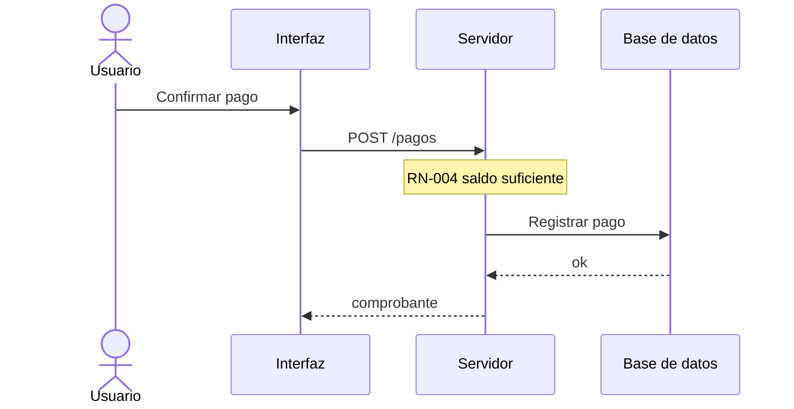
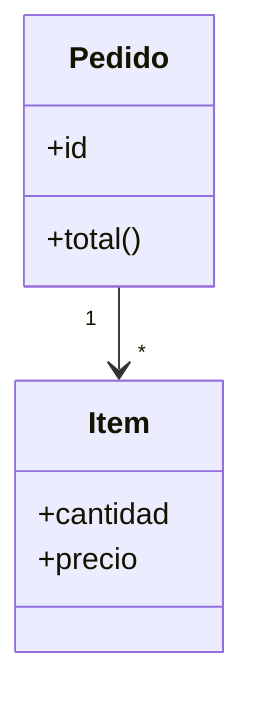
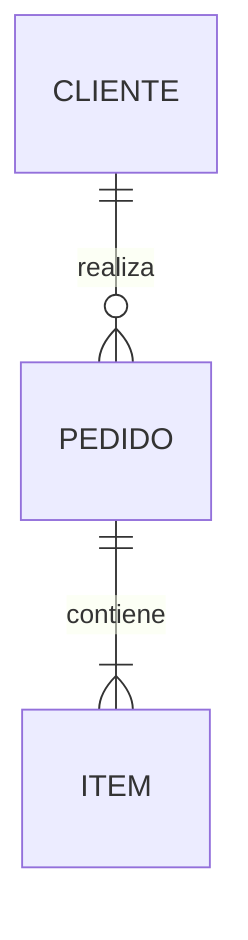
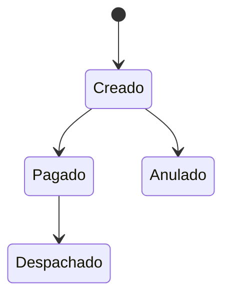

# Diagramas legibles con Mermaid

Mermaid se escribe como texto, vive en el repositorio y GitHub lo muestra dibujado. Un diagrama sirve solo si quien lo abre lo entiende en pocos segundos.

## Contenido
1. Reglas
2. Qué diagrama elegir
3. Plantilla de presentación
4. Ejemplos mínimos
5. Cómo dividir un diagrama grande
6. En el README

## 1. Reglas

1. **Una pregunta por diagrama**, escrita en el título y en una línea de descripción ("¿Cómo se paga un pedido?").
2. **Límites** (los controla `scripts/diagramas.py`; ajustables en `docs/.diagramas.json`):
   - Clases: hasta 10 por diagrama y hasta 8 miembros por clase. Mostrar solo lo relevante para la pregunta, no todos los atributos.
   - Secuencia: hasta 8 participantes y 20 mensajes.
   - Flujo o estados: hasta 15 nodos.
   - Entidad-relación: hasta 10 entidades.
3. **Si no entra, se divide.** Nunca "el diagrama de todo".
4. Dirección de lectura consistente (`flowchart LR` o `TD`, y no mezclar), nombres cortos y significativos, sin cruces de líneas innecesarios.
5. Si la notación tiene algo especial (colores, líneas punteadas), agregar una leyenda de una línea.
6. Citar el ID de la regla en notas cuando corresponda (`Note over Pedido: RN-004`).

## 2. Qué diagrama elegir

| Pregunta | Diagrama |
|---|---|
| ¿Quién habla con quién, y en qué orden? | Secuencia |
| ¿Qué piezas existen y cómo se relacionan? | Clases (o componentes con flujo) |
| ¿Qué datos se guardan y cómo se vinculan? | Entidad-relación |
| ¿Cómo cambia de estado algo? | Estados |
| ¿Cómo se decide o fluye un proceso? | Flujo |

## 3. Plantilla de presentación

Encabezado, descripción de una línea y el bloque. El verificador exige título y descripción.

````markdown
### Pago de un pedido

¿Qué pasos siguen la interfaz, el servidor y la base de datos al pagar un pedido?


````

## 4. Ejemplos mínimos

Clases (solo lo relevante para la pregunta):



Entidad-relación:



Estados:



## 5. Cómo dividir un diagrama grande

1. Dibujar primero un **diagrama general** con 5 a 8 cajas que son las áreas o casos de uso.
2. Hacer un **diagrama de detalle por cada caja** que lo necesite, cada uno con su pregunta.
3. En el general, enlazar a los detalles con un texto debajo (`Detalle: [[pago-de-pedido]]`).
4. Los diagramas de detalle viven en `docs/diagramas/` con nombre que diga la pregunta (`pago-de-pedido.md`).
5. Correr `diagramas.py`; si algo excede, repetir la división.

## 6. En el README

El README orienta, así que muestra la arquitectura y los flujos principales dibujados, cada uno con un texto breve debajo, y el detalle queda en `docs/diagramas/`.

- **Cuáles:** la arquitectura (módulos y dependencias), de uno a tres flujos de secuencia y, si el proyecto gira en torno a datos, el entidad-relación. **Hasta 4 en total.** Un diagrama de clases de todo es ruido; si hace falta uno, de las pocas clases troncales.
- **Más chicos que en `docs/`**, porque se leen al ancho de la página: flujo de hasta 12 nodos, secuencia de hasta 6 participantes y 12 mensajes, entidad-relación de hasta 8 entidades, clases de hasta 8 con 6 miembros.
- **Una sola fuente:** el diagrama se copia desde `docs/diagramas/` con `senior-docs/scripts/readme_diagramas.py` entre marcas `<!-- diagrama: ruta#n -->` y `<!-- /diagrama -->`. No se edita en el README; se edita la fuente y se hace `sync`.
- **El texto de debajo** (hasta 400 caracteres) lo escribe una persona y dice qué se ve y qué mirar: «Las rutas llaman a los controladores y estos a los servicios». No repite el diagrama.
- **Provisorio o confirmado:** un diagrama inferido del código lleva la nota «sin confirmar»; al confirmarlo (`documentar.py confirmar-diagrama`) y hacer `sync`, la nota sale.
- **Sin renderizar a imagen:** se usa el Mermaid que GitHub dibuja solo; convertirlo a imagen necesitaría una herramienta externa y la aprobación del usuario.
